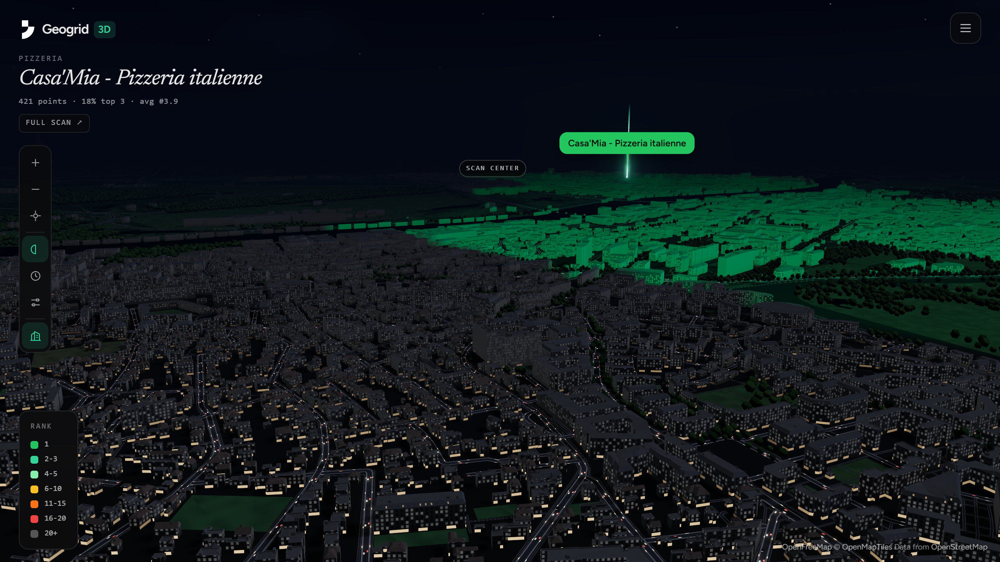
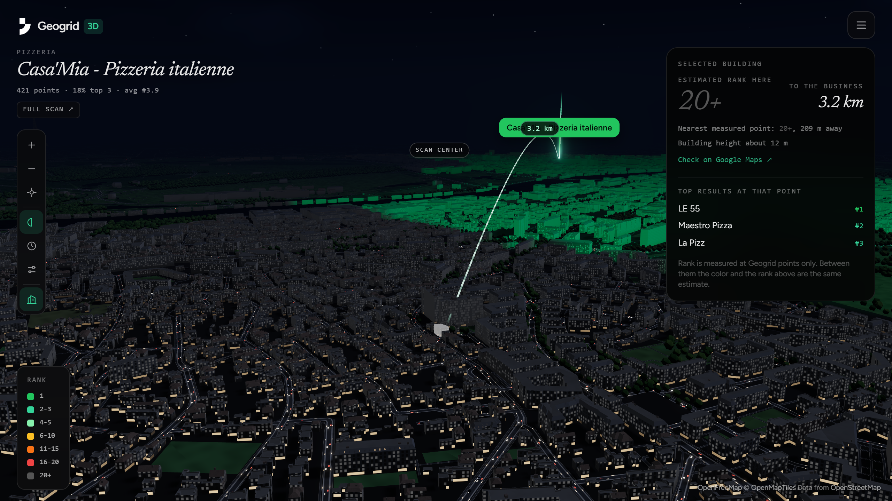
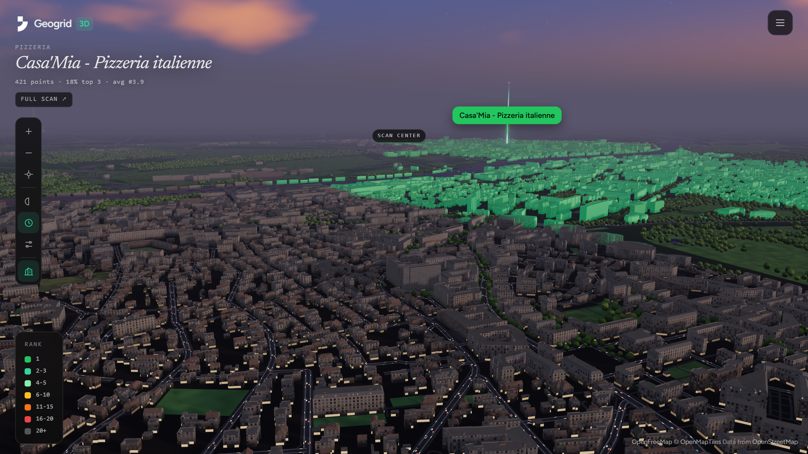
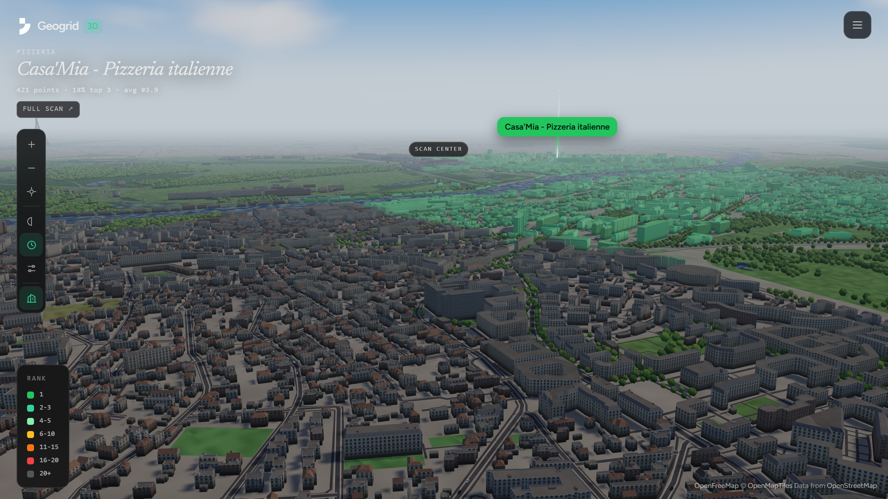
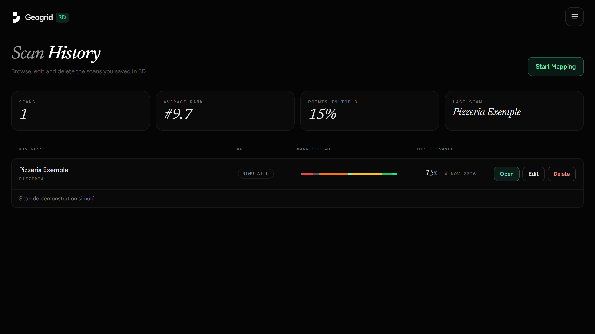
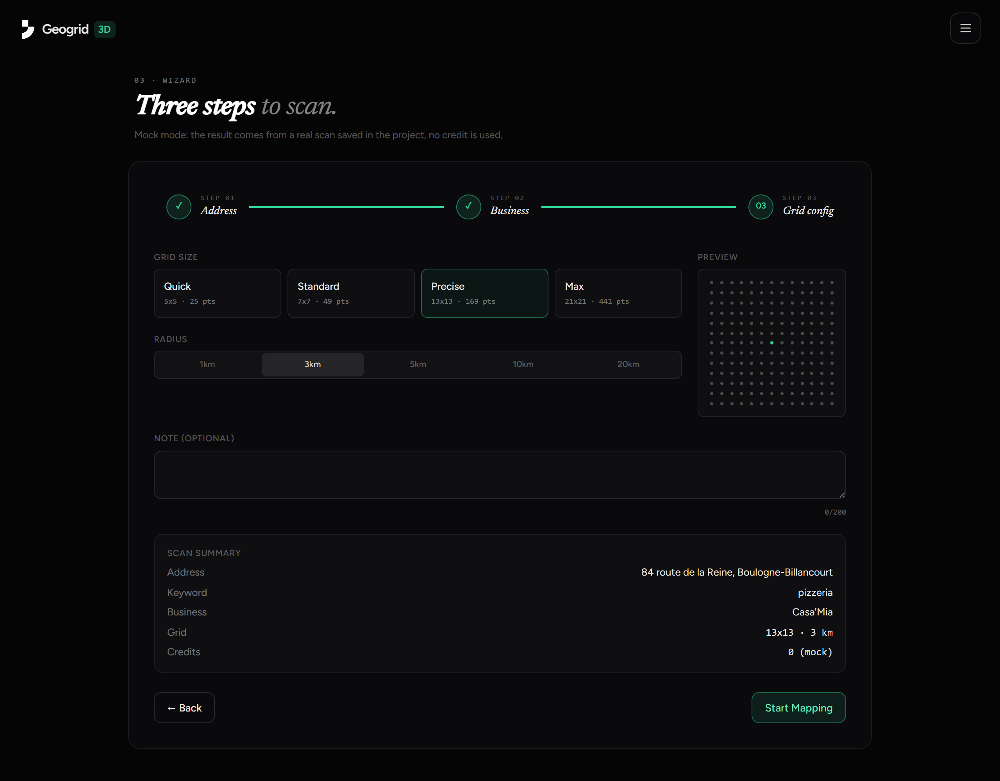

# Geogrid 3D



Projet d'école réalisé pour le cours Angular de l'IIM.

**Démo en ligne : https://3d.geogrid.dev**

[Geogrid](https://geogrid.dev) mesure la position d'un commerce sur Google Maps, point par point, sur une grille géographique. Geogrid 3D affiche ce résultat dans une ville en 3D : on se déplace dans les rues, on clique sur un immeuble, et le classement estimé à cet endroit s'affiche.

Le rang est mesuré aux points du scan, pas à chaque immeuble. Entre deux points, la couleur et le rang affichés sont une estimation.

## En images

Le scan de démonstration est un vrai scan Geogrid en 21x21 sur un rayon de 5 km autour de Boulogne-Billancourt, pour le mot-clé « pizzeria ». Les couleurs reprennent la palette de Geogrid, et l'écart entre le vert et le gris se lit directement dans la ville.

Un clic sur un immeuble affiche le rang estimé à cet endroit, le point mesuré le plus proche, la distance au commerce et les meilleurs résultats.



Plusieurs modes visuels changent la lumière et le ciel. Ici Dusk et Day, avec Building colors.





La collection garde les scans sauvegardés, avec leur rang moyen et la répartition de leurs rangs.



L'assistant crée un scan en 3 étapes : adresse, commerce, puis taille de grille et rayon.



## Fonctionnalités

- **Ville 3D** : bâtiments, routes, eau et parcs d'OpenStreetMap, chargés autour de la caméra. Toits (tuiles, zinc, terrasses), cheminées, marquages au sol, arbres et voitures sont générés.
- **Modes d'affichage** : Standard (sombre), Real time (soleil selon l'heure et le lieu du scan), Dusk, Day et Night.
- **Building colors** : colore les immeubles selon le rang, avec la palette de Geogrid.
- **Clic sur un immeuble** : rang estimé, point mesuré le plus proche, distance au commerce et meilleurs résultats à ce point.
- **Collection** : les scans sont sauvegardés, modifiables (note, tag) et supprimables.
- **Assistant de scan** : formulaire réactif en 3 étapes avec validation, grilles de 5x5 à 21x21, rayon de 1 à 20 km.

## Prérequis

- Node.js et npm (développé avec Node 24 et npm 11)
- Un navigateur avec WebGL2 et une carte graphique correcte
- Une connexion internet pour les tuiles de carte

## Installation et lancement

```bash
npm install
npm run dev
```

L'application s'ouvre sur http://localhost:4200.

`npm run dev` lance trois processus :

| Processus | Port | Rôle |
|---|---|---|
| `ng serve` | 4200 | Application Angular |
| `npm run api` | 3001 | json-server, API de la collection |
| `npm run proxy` | 3002 | Proxy vers l'API Geogrid, utile en mode live |

Au premier lancement, `db.json` est créé à partir de `db.seed.json`. Ce fichier n'est pas versionné : supprimez-le pour revenir aux données de départ.

## Mode mock et mode live

Le mode se choisit avec `SCAN_MODE` dans `src/app/data/scan.ts`.

- **`mock`** (par défaut) : le résultat vient d'un vrai scan Geogrid figé dans `public/mock/`. Aucune clé ni aucun crédit nécessaire.
- **`live`** : lance un vrai scan via l'API de Geogrid. Chaque point coûte un crédit, et il faut une clé d'un compte payant :

```bash
cp .env.example .env
# puis renseigner GEOGRID_API_KEY dans .env
```

La clé reste côté serveur : le proxy ajoute l'en-tête `Authorization`, le navigateur ne la voit jamais. Le fichier `.env` est ignoré par git.

## Build

```bash
npm run build
```

Le résultat est généré dans `dist/geogrid-3d/`.

## Déploiement sur Vercel

`vercel.json` configure le build, le routage de l'application et l'API. Aucune variable d'environnement n'est nécessaire en mode mock.

Sur Vercel, json-server tourne dans une fonction (`api/collection.mjs`). Le disque n'y est pas conservé : la collection reste en mémoire et revient au contenu de `db.seed.json` quand la fonction redémarre. Les scans ajoutés ou modifiés ne sont donc pas durables en ligne.

## Architecture

```
src/
  app/
    data/     ScanStore (signaux) et ScanSource (mock ou live)
    pages/    Explore, collection, nouveau scan, détail, à propos
    ui/       Composants standalone : carte, vue du scan, carte de scan, légende
  lib/        Moteur 3D en JavaScript, sans dépendance à Angular
    scan-map.js          Rendu, caméra, chargement, sélection
    engine/tile.worker.js  Construction de la géométrie dans des workers
    engine/field.js      Estimation du rang en tout point
    engine/materials.js  Shaders
    engine/sky.js        Ciel et réglages de chaque mode
    engine/landmarks.js  Tour Eiffel et pyramide du Louvre
server/proxy.mjs         Proxy de la clé API, en local
api/collection.mjs       json-server sur Vercel
```

## Notions Angular utilisées

- Composants standalone avec `input()` et `output()`
- Service `ScanStore` : signal privé, vue en lecture seule, `computed()` (rang moyen, part du top 3, tri)
- Routes chargées à la demande, dont `/scans/:id` avec paramètre
- Formulaire réactif avec validateurs et erreurs affichées sous les champs
- CRUD sur json-server avec nouvelles tentatives et annulation du changement local si l'écriture échoue
- États de chargement, d'erreur et de liste vide

## Technologies

Angular 22, Three.js, Tailwind CSS v4, json-server, tuiles [OpenFreeMap](https://openfreemap.org).

Données cartographiques : © [OpenMapTiles](https://www.openmaptiles.org/), © les contributeurs [OpenStreetMap](https://www.openstreetmap.org/copyright). Le rendu s'inspire de [Streets GL](https://github.com/StrandedKitty/streets-gl), sans en reprendre le code.

## Limites connues

- La création de scan depuis l'assistant et le mode live n'ont pas encore été testés de bout en bout.
- Le scan d'exemple a le statut partiel : 421 points mesurés sur 441.
- En mode mock, l'assistant renvoie toujours le scan d'exemple : l'adresse, la grille et le rayon choisis n'ont pas d'effet sur le résultat.
- Les hauteurs absentes d'OpenStreetMap sont estimées d'après la taille au sol du bâtiment.
- Sur une machine modeste, activer **Low power** dans Settings.
