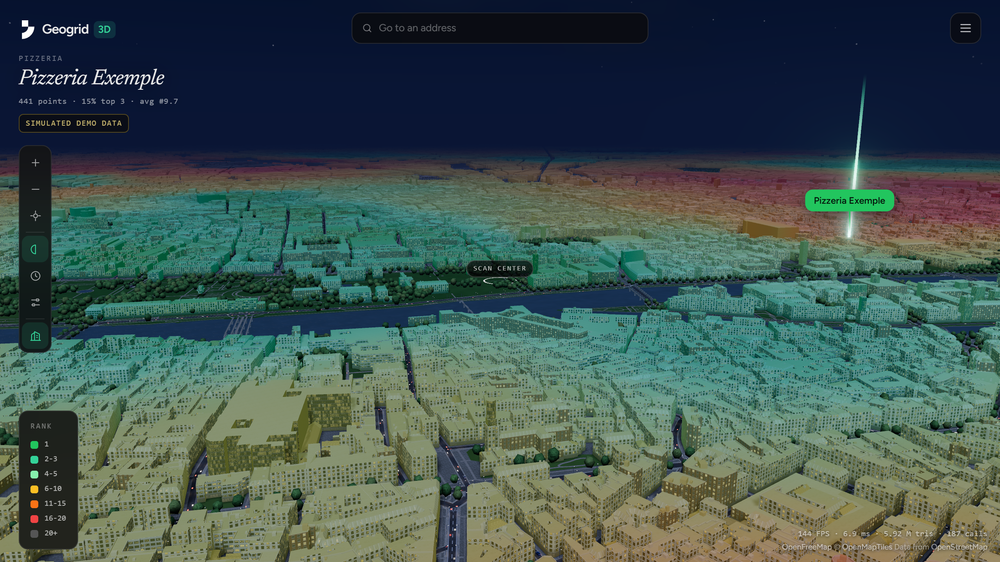
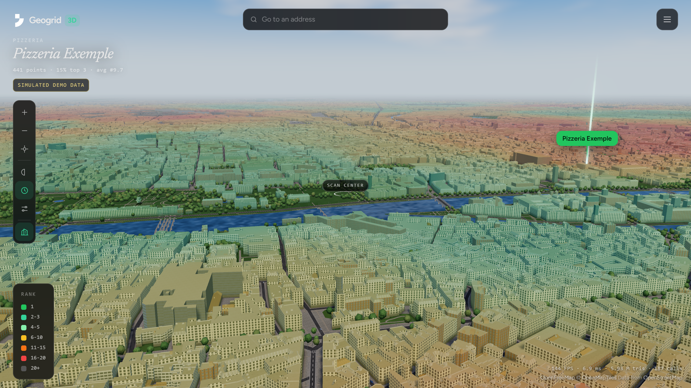
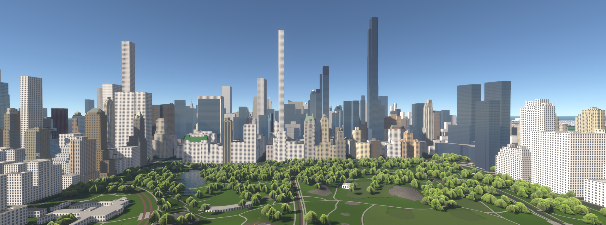

# Geogrid 3D


Projet d'école réalisé pour le cours Angular de l'IIM.

**Démo en ligne : https://3d.geogrid.dev**

[Geogrid](https://geogrid.dev) mesure la position d'un commerce sur Google Maps, point par point, sur une grille géographique. Geogrid 3D affiche ce résultat dans une ville en 3D : on se déplace dans les rues, on clique sur un immeuble, et le classement estimé à cet endroit s'affiche.

Le rang est mesuré aux points du scan, pas à chaque immeuble. Entre deux points, la couleur et le rang affichés sont une estimation.

## En images

Le scan de démonstration est **simulé** : le commerce et les concurrents sont fictifs, et les rangs sont générés par `scripts/demo-scan.mjs` sur une grille 21x21 autour du centre de Paris. Il montre ce que donne un scan varié, ce n'est pas une mesure de Geogrid, et l'interface l'indique. Le mode live affiche de vraies mesures.

La vue par défaut montre la ville sans colorer les immeubles : le scan se lit sur le sol, les routes et les vitrines. Le bouton **Building colors** colore chaque immeuble selon le rang estimé, avec la palette de Geogrid.



Un clic sur un immeuble affiche le rang estimé à cet endroit, le point mesuré le plus proche, la distance au commerce et les meilleurs résultats.


Plusieurs modes visuels changent la lumière et le ciel. Ici Dusk et Day, sans Building colors, puis Day avec.




La collection garde les scans sauvegardés, avec leur rang moyen et la répartition de leurs rangs.


L'assistant crée un scan en 3 étapes : adresse, commerce, puis taille de grille et rayon.


## Inspiration : Streets GL

Le rendu vise celui de [Streets GL](https://streets.gl) ([dépôt](https://github.com/StrandedKitty/streets-gl)), un moteur WebGL qui construit une ville 3D depuis les données OpenStreetMap, avec de vraies façades, des arbres et un éclairage soigné. Je l'ai découvert à sa sortie et je le trouve exceptionnel.



*Capture : Streets GL, par StrandedKitty, licence MIT.*

Je ne l'ai pas réutilisé, pour trois raisons : c'est son propre moteur, pas une librairie que l'on pilote depuis Angular, il faudrait donc modifier son code source ; il n'a pas été mis à jour depuis longtemps ; et il est lourd à embarquer. Il fallait aussi recolorer chaque immeuble selon le rang d'un scan, donc contrôler le rendu de bout en bout. J'ai donc écrit un moteur Three.js de zéro, avec le même parti pris visuel : bâtiments et routes d'OpenStreetMap, lumière réaliste, aucun quadrillage.

## Fonctionnalités

- **Ville 3D** : bâtiments, routes, eau et parcs d'OpenStreetMap, chargés autour de la caméra. Toits (tuiles, zinc, terrasses), cheminées, marquages au sol, arbres et voitures sont générés.
- **Compteur FPS** : en bas à droite de la vue 3D.
- **Modes d'affichage** : Standard (sombre), Real time (soleil selon l'heure et le lieu du scan), Dusk, Day et Night.
- **Building colors** : colore les immeubles selon le rang, avec la palette de Geogrid.
- **Recherche d'adresse** : se téléporte à n'importe quelle adresse (géocodage Nominatim), puis ouvre l'assistant avec cette adresse.
- **Clic sur un immeuble** : rang estimé, point mesuré le plus proche, distance au commerce et meilleurs résultats à ce point.
- **Collection** : les scans sont sauvegardés, modifiables (note, tag) et supprimables.
- **Assistant de scan** : formulaire réactif en 3 étapes avec validation, grilles de 5x5 à 21x21, rayon de 1 à 20 km.

## Prérequis

- Node.js 22.22.3 ou plus, ou 24.15 ou plus, avec npm (Angular 22 refuse les versions plus anciennes : `ng serve` s'arrête avec « The Angular CLI requires a minimum Node.js version »). Développé avec Node 24 et npm 11
- Un navigateur avec WebGL2 et une carte graphique correcte
- Une connexion internet pour les tuiles de carte

## Installation et lancement

```bash
npm install
npm run dev
```

L'application s'ouvre sur http://localhost:4200.

`npm run dev` lance trois processus :

| Processus | Port | Rôle |
|---|---|---|
| `ng serve` | 4200 | Application Angular |
| `npm run api` | 3001 | json-server, API de la collection |
| `npm run proxy` | 3002 | Proxy vers l'API Geogrid, utile en mode live |

Au premier lancement, `db.json` est créé à partir de `db.seed.json`. Ce fichier n'est pas versionné : supprimez-le pour revenir aux données de départ.

## Mode mock et mode live

Le mode se choisit avec `SCAN_MODE` dans `src/app/data/scan.ts`.

- **`mock`** (par défaut) : le résultat est le scan simulé de `public/mock/`. Aucune clé ni aucun crédit nécessaire.
- **`live`** : lance un vrai scan via l'API de Geogrid. Chaque point coûte un crédit, et il faut une clé d'un compte payant :

```bash
cp .env.example .env
# puis renseigner GEOGRID_API_KEY dans .env
```

La clé reste côté serveur : le proxy ajoute l'en-tête `Authorization`, le navigateur ne la voit jamais. Le fichier `.env` est ignoré par git.

## Build

```bash
npm run build
```

Le résultat est généré dans `dist/geogrid-3d/`.

## Déploiement sur Vercel

`vercel.json` configure le build, le routage de l'application et l'API. Aucune variable d'environnement n'est nécessaire en mode mock.

Sur Vercel, json-server tourne dans une fonction (`api/collection.mjs`). Le disque n'y est pas conservé : la collection reste en mémoire et revient au contenu de `db.seed.json` quand la fonction redémarre. Les scans ajoutés ou modifiés ne sont donc pas durables en ligne.

## Architecture

```
src/
  app/
    data/     ScanStore (signaux) et ScanSource (mock ou live)
    pages/    Explore, collection, nouveau scan, détail, à propos
    ui/       Composants standalone : carte, vue du scan, carte de scan, légende
  lib/        Moteur 3D en JavaScript, sans dépendance à Angular
    scan-map.js          Rendu, caméra, chargement, sélection
    engine/tile.worker.js  Construction de la géométrie dans des workers
    engine/field.js      Estimation du rang en tout point
    engine/materials.js  Shaders
    engine/sky.js        Ciel et réglages de chaque mode
    engine/landmarks.js  Tour Eiffel et pyramide du Louvre
server/proxy.mjs         Proxy de la clé API, en local
api/collection.mjs       json-server sur Vercel
```

## Notions Angular utilisées

- Composants standalone avec `input()` et `output()`
- Service `ScanStore` : signal privé, vue en lecture seule, `computed()` (rang moyen, part du top 3, tri)
- Routes chargées à la demande, dont `/scans/:id` avec paramètre
- Formulaire réactif avec validateurs et erreurs affichées sous les champs
- CRUD sur json-server avec nouvelles tentatives et annulation du changement local si l'écriture échoue
- États de chargement, d'erreur et de liste vide

## Technologies

Angular 22, Three.js, Tailwind CSS v4, json-server, tuiles [OpenFreeMap](https://openfreemap.org).

Données cartographiques : © [OpenMapTiles](https://www.openmaptiles.org/), © les contributeurs [OpenStreetMap](https://www.openstreetmap.org/copyright). Le rendu s'inspire de [Streets GL](https://streets.gl), sans en reprendre le code (voir ci-dessous).

## Démarche et usage de l'IA

Le projet a été construit avec Claude Code (Anthropic), un agent qui lit le dépôt, écrit le code et lance les commandes. Claude a écrit le code, en reprenant surtout celui de Geogrid, que j'ai créé et que je développe depuis plusieurs mois. Mon rôle a été de décider quoi construire, de vérifier, de juger le résultat et de le corriger.

### Les choix

- **Un moteur Three.js écrit pour le projet.** Le prototype a d'abord utilisé MapLibre, puis deck.gl. Les deux limitaient le rendu visé, inspiré de Streets GL, donc j'ai demandé de repartir de zéro.
- **Pas de grille visible.** Geogrid mesure des points. Afficher des cases aurait donné un quadrillage : le rang est donc estimé entre les points, et l'interface dit clairement que c'est une estimation.
- **Un scan de démonstration simulé.** Les vrais scans essayés donnaient peu de variété à l'écran : un commerce local n'est classé que dans sa commune et ses voisines, et le rang change à peine à l'intérieur de Paris. La démo utilise donc des données générées, annoncées comme telles, sur un commerce fictif. Le mode mock tourne sans clé ni crédit. La clé API ne va jamais dans le navigateur ni dans le dépôt : un proxy local l'ajoute côté serveur.
- **Le projet reste séparé de Geogrid.** Il ne touche pas au produit.

### Mon organisation : un pilote et des agents

Sur mes projets, je ne parle pas directement à chaque agent. J'ai un outil de bureau, Rune compagnon, relié à Claude Code par MCP, avec des plugins et des connexions à mes outils.

1. Je décris la tâche en quelques phrases, souvent à la voix.
2. Un agent **pilote** la découpe et crée les agents qui font le travail.
3. Les agents parlent au pilote, pas à moi. Si l'un d'eux hésite, il pose sa question au pilote, qui me la transmet. Je réponds, et le pilote renvoie la réponse à l'agent.
4. Le pilote me remonte les résultats et vérifie le reste du travail.

Tout est centralisé : je ne suis qu'un seul fil de discussion, au lieu de surveiller plusieurs agents. Je garde les décisions et le jugement du résultat.

### Un projet simple, sauf la 3D

La partie métier était déjà faite dans Geogrid : le système de scan, les rangs, l'API, les crédits. Il n'y avait presque rien à réinventer, il fallait l'importer. Les deux vraies nouveautés ont été :

- **Le moteur 3D**, écrit de zéro, qui a pris la majorité du temps (voir « Inspiration : Streets GL »).
- **Angular**. Je connaissais les bases, mais pas à l'usage, et ce n'est pas un framework que j'aime. Il a fallu comprendre comment ce qui marche dans Next et React se traduit en Angular : les props deviennent des `input()`, les callbacks des `output()`, l'état local un `signal()`, et les valeurs dérivées un `computed()`.

### Comment j'ai utilisé l'IA

**Donner le contexte une fois pour toutes.** `NOTES-IA.md` décrit l'architecture, les réglages et les pièges. L'agent le lit à chaque reprise, et je n'ai pas à tout réexpliquer. Il contient aussi les décisions prises et ce qui reste à faire.

**Montrer plutôt que décrire.** La plupart de mes retours sont des captures d'écran avec une phrase courte. Le compteur de FPS, avec le nombre de triangles et d'appels de rendu, a transformé « ça rame » en un chiffre exploitable.

**Exemples de prompts réels :**

- « Peut-être avoir de vrai route ? » (avec une capture)
- « Pouvoir chercher une adresse […] pouvoir se tp à une adresse ? et qu'on puisse aller n'importe ou mais optimise »
- « mais oui lui utilise des textures directement, on peut pas optimisé et rendre encore plus beau ? pas forcément plus de détail mais une meilleur lumière, texture ? »
- « la route est bizarre et arbre aussi […] en zoomant et quand je me déplace, à peine 30fps » (avec une capture du compteur)
- « juste quand on bouge plus, le site se met en 15fps »

**Vérifier, parce que l'IA se trompe.** Trois exemples de ce projet :

- L'agent a mesuré 15 FPS dans ses propres tests et a cherché un problème de performance. La cause était une limite qu'il avait lui-même ajoutée quand la caméra ne bouge pas. C'est mon retour sur ma machine qui l'a révélé.
- Aucun toit en pente n'était généré, à cause d'une fonction qui élargissait les bâtiments au lieu de les réduire. Le bug n'est apparu qu'en regardant le rendu de près.
- Les premiers ponts étaient cassés, parce que chaque tronçon d'OpenStreetMap avait ses propres rampes et que le tablier restait au sol alors que les piles montaient. Je l'ai signalé sur capture, et le correctif raccorde les tronçons et fait suivre la hauteur au tablier.

## Limites connues

- La création de scan depuis l'assistant et le mode live n'ont pas encore été testés de bout en bout.
- Le scan d'exemple est simulé : ses rangs ne disent rien du classement réel d'un commerce.
- En mode mock, l'assistant renvoie toujours le scan d'exemple : l'adresse, la grille et le rayon choisis n'ont pas d'effet sur le résultat.
- Les hauteurs absentes d'OpenStreetMap sont estimées d'après la taille au sol du bâtiment.
- Sur une machine modeste, activer **Low power** dans Settings.
